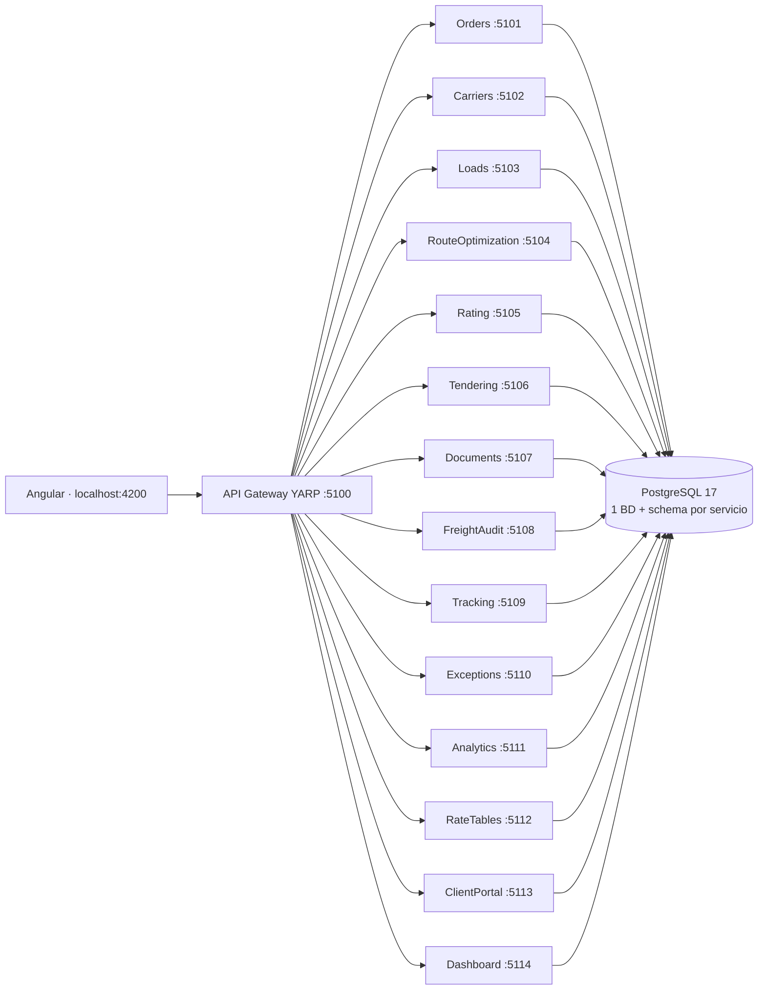
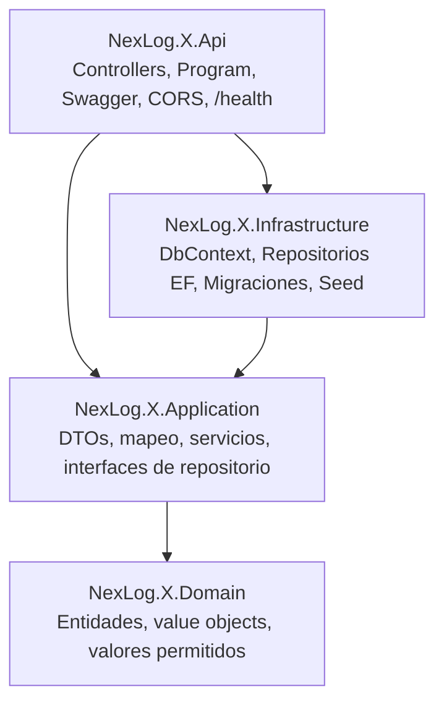

# NexLog TMS · Backend (.NET 10)

Web API del TMS NexLog: **14 microservicios** en .NET 10 con **Clean Architecture** (Domain / Application / Infrastructure / Api), **EF Core 10 + PostgreSQL (Npgsql)**, un **API Gateway YARP** y building blocks compartidos. Los modelos están alineados con el frontend Angular (`../src/app/core/models`, rama `develop`).

## Arquitectura



Cada servicio en `src/Services/<Nombre>/`:



```
backend/
├── NexLog.sln
├── Directory.Build.props / Directory.Packages.props   (net10.0, versiones centralizadas)
├── docker-compose.yml · Dockerfile
├── src/BuildingBlocks/
│   ├── NexLog.BuildingBlocks       Entity base, Result/Error, PageQuery/PagedResult, excepciones, IRepository, CrudService
│   └── NexLog.BuildingBlocks.Web   EfRepository, columnas jsonb, CrudControllerBase, middleware de excepciones (ProblemDetails), hosting común
├── src/ApiGateway/NexLog.ApiGateway   YARP: /api/* → servicio
└── src/Services/<14 servicios>/NexLog.<X>.{Domain,Application,Infrastructure,Api}
```

Decisiones:
- **Ids `string`** como en el frontend (`ORD-2025-00125`, `CR-001`, `LD-2026-0842`…). En POST el `id` es opcional; si falta se genera `<PREFIJO>-XXXXXXXX`.
- **Estados/prioridades/equipos** se guardan con los mismos strings del frontend (`"In Transit"`, `"order-created"`, `"High"`…) y se validan con `[AllowedValues]` → 400 si no coinciden.
- Objetos anidados (origen/destino, timeline, líneas de factura, stops, alertas…) se guardan como **`jsonb`**; listas simples (`equipment`) como `text[]`.
- JSON en **camelCase**, idéntico a las interfaces TypeScript.
- Un `DbContext` y una base de datos (`nexlog_<schema>`) + schema propio por servicio; migración `InitialCreate` incluida en cada `Infrastructure/Persistence/Migrations`.
- Al arrancar: `Database:MigrateOnStartup=true` aplica migraciones y `Database:Seed=true` carga datos de ejemplo parecidos a los mocks.

## Servicios y alineación con el frontend

| Servicio | Puerto | Schema / BD | Frontend (features / models) |
|---|---|---|---|
| Orders | 5101 | `orders` (BD `nexlog_orders`) | orders/, order-detail/ → `order.model.ts` (Order, OrderDetail) · `order.service.ts` |
| Carriers | 5102 | `carriers` (BD `nexlog_carriers`) | carrier-management/ → `carrier.model.ts` · `carrier.service.ts` |
| Loads | 5103 | `loads` (BD `nexlog_loads`) | load-planning/ → `load.model.ts` (Load, Trailer), PlanningOrder · `load.service.ts` |
| RouteOptimization | 5104 | `routing` (BD `nexlog_routing`) | route-optimization/ → `route.model.ts` (OptRoute, Stop, RouteSummary) |
| Rating | 5105 | `rating` (BD `nexlog_rating`) | rating/ → `quote.model.ts` (CarrierQuote, QuoteRequest) · `rating.service.ts` |
| Tendering | 5106 | `tendering` (BD `nexlog_tendering`) | tendering/ → Load con TenderStatus + cascada |
| Documents | 5107 | `documents` (BD `nexlog_documents`) | documents/ → `document.model.ts` (DocumentItem, EpodData) |
| FreightAudit | 5108 | `freight_audit` (BD `nexlog_freight_audit`) | freight-audit/ → `invoice.model.ts` (FreightInvoice, InvoiceLine) |
| Tracking | 5109 | `tracking` (BD `nexlog_tracking`) | tracking/ → `shipment.model.ts` (Shipment, alerts, timeline) |
| Exceptions | 5110 | `exceptions` (BD `nexlog_exceptions`) | exception-management/ → `exception.model.ts` (ExceptionItem) |
| Analytics | 5111 | `analytics` (BD `nexlog_analytics`) | analytics → `analytics.model.ts` (AnalyticsData) |
| RateTables | 5112 | `rate_tables` (BD `nexlog_rate_tables`) | rate-tables/ → `rate-table.model.ts` (RateTable, RolePermission) |
| ClientPortal | 5113 | `client_portal` (BD `nexlog_client_portal`) | client-portal/ → `client-portal.model.ts` (PortalShipment) |
| Dashboard | 5114 | `dashboard` (BD `nexlog_dashboard`) | dashboard/ → `dashboard.model.ts` (KPI, Alert con claves i18n) |
| ApiGateway | 5100 | — | Punto de entrada único para Angular |

## Endpoints (128 en total)

Lista paginada: `GET /api/<recurso>?page=1&pageSize=20&search=texto&status=Active&descending=false` → `{ items, page, pageSize, totalCount, totalPages }`.
Errores en formato ProblemDetails (404 no encontrado, 409 id duplicado, 400 validación).

| Servicio | Ruta | Métodos |
|---|---|---|
| Orders | `/api/orders` | GET (lista paginada), GET `/{id}`, POST, PUT `/{id}`, DELETE `/{id}` |
| Orders | `/api/order-details` | GET (lista paginada), GET `/{id}`, POST, PUT `/{id}`, DELETE `/{id}` |
| Carriers | `/api/carriers` | GET (lista paginada), GET `/{id}`, POST, PUT `/{id}`, DELETE `/{id}` |
| Loads | `/api/loads` | GET (lista paginada), GET `/{id}`, POST, PUT `/{id}`, DELETE `/{id}` |
| Loads | `/api/trailers` | GET (lista paginada), GET `/{id}`, POST, PUT `/{id}`, DELETE `/{id}` |
| Loads | `/api/planning-orders` | GET (lista paginada), GET `/{id}`, POST, PUT `/{id}`, DELETE `/{id}` |
| RouteOptimization | `/api/routes` | GET (lista paginada), GET `/{id}`, POST, PUT `/{id}`, DELETE `/{id}` |
| RouteOptimization | `/api/route-runs` | GET (lista paginada), GET `/{id}`, POST, PUT `/{id}`, DELETE `/{id}` |
| RouteOptimization | `/api/routes/summary` | GET |
| Rating | `/api/quotes` | GET (lista paginada), GET `/{id}`, POST, PUT `/{id}`, DELETE `/{id}` |
| Rating | `/api/quotes/search` | POST |
| Tendering | `/api/tenders` | GET (lista paginada), GET `/{id}`, POST, PUT `/{id}`, DELETE `/{id}` |
| Tendering | `/api/tenders/{id}/accept` | POST |
| Tendering | `/api/tenders/{id}/reject` | POST |
| Documents | `/api/documents` | GET (lista paginada), GET `/{id}`, POST, PUT `/{id}`, DELETE `/{id}` |
| Documents | `/api/epods` | GET (lista paginada), GET `/{id}`, POST, PUT `/{id}`, DELETE `/{id}` |
| FreightAudit | `/api/invoices` | GET (lista paginada), GET `/{id}`, POST, PUT `/{id}`, DELETE `/{id}` |
| Tracking | `/api/shipments` | GET (lista paginada), GET `/{id}`, POST, PUT `/{id}`, DELETE `/{id}` |
| Tracking | `/api/shipments/{id}/events` | GET |
| Tracking | `/api/shipments/{id}/events` | POST |
| Exceptions | `/api/exceptions` | GET (lista paginada), GET `/{id}`, POST, PUT `/{id}`, DELETE `/{id}` |
| Analytics | `/api/lane-costs` | GET (lista paginada), GET `/{id}`, POST, PUT `/{id}`, DELETE `/{id}` |
| Analytics | `/api/carrier-performance` | GET (lista paginada), GET `/{id}`, POST, PUT `/{id}`, DELETE `/{id}` |
| Analytics | `/api/on-time-trends` | GET (lista paginada), GET `/{id}`, POST, PUT `/{id}`, DELETE `/{id}` |
| Analytics | `/api/mode-volumes` | GET (lista paginada), GET `/{id}`, POST, PUT `/{id}`, DELETE `/{id}` |
| Analytics | `/api/analytics` | GET |
| RateTables | `/api/rate-tables` | GET (lista paginada), GET `/{id}`, POST, PUT `/{id}`, DELETE `/{id}` |
| RateTables | `/api/role-permissions` | GET (lista paginada), GET `/{id}`, POST, PUT `/{id}`, DELETE `/{id}` |
| ClientPortal | `/api/portal/shipments` | GET (lista paginada), GET `/{id}`, POST, PUT `/{id}`, DELETE `/{id}` |
| ClientPortal | `/api/portal/track/{trackingNumber}` | GET |
| Dashboard | `/api/dashboard/kpis` | GET (lista paginada), GET `/{id}`, POST, PUT `/{id}`, DELETE `/{id}` |
| Dashboard | `/api/dashboard/alerts` | GET (lista paginada), GET `/{id}`, POST, PUT `/{id}`, DELETE `/{id}` |
| Todos | `/health`, `/swagger` | GET |

## Cómo correrlo

Requisitos: .NET SDK 10, PostgreSQL 15+ (o Docker).

### Opción A · Docker Compose (todo junto)

```bash
cd backend
docker compose up --build
# Gateway: http://localhost:5100/api/orders   ·   Servicios: http://localhost:5101..5114/swagger
```

### Opción B · Local con `dotnet run`

```bash
cd backend
dotnet restore && dotnet build NexLog.sln
# Postgres local (usuario/clave por defecto postgres/postgres, ver appsettings.json de cada Api)
docker run -d --name nexlog-pg -e POSTGRES_PASSWORD=postgres -p 5432:5432 postgres:17

# Un servicio (migra y siembra al arrancar):
dotnet run --project src/Services/Orders/NexLog.Orders.Api        # http://localhost:5101/swagger
# Gateway:
dotnet run --project src/ApiGateway/NexLog.ApiGateway             # http://localhost:5100
```

### Migraciones con dotnet-ef

```bash
dotnet tool restore     # dotnet-ef 10 (definido en .config/dotnet-tools.json)
S=Orders
dotnet ef database update -p src/Services/$S/NexLog.$S.Infrastructure -s src/Services/$S/NexLog.$S.Api
# Nueva migración tras cambiar entidades:
dotnet ef migrations add <Nombre> -p src/Services/$S/NexLog.$S.Infrastructure -s src/Services/$S/NexLog.$S.Api -o Persistence/Migrations
```

Para aplicar migraciones solo manualmente pon `"Database": { "MigrateOnStartup": false }`.

### Conectar Angular

Apunta los servicios del frontend a `http://localhost:5100/api/...` (CORS ya permite `http://localhost:4200`; configurable en `Cors:Origins`). Las listas vienen paginadas: usa `response.items`.

## Pendiente / siguientes pasos
- Pruebas de integración automatizadas para auth (hoy se prueba con `tools/auth-test`).
- Paginación del lado servidor en las tablas del frontend (hoy pide hasta 200 filas).
- Mensajería entre servicios (p. ej. Tendering → Loads, Tracking → Exceptions) con eventos (RabbitMQ/MassTransit).
- Tests unitarios/integración (Testcontainers).

## Seguridad · Auth0 (JWT Bearer)

El frontend inicia sesión con Auth0 (`@auth0/auth0-angular`) y manda un **access token RS256** en `Authorization: Bearer …` a cada llamada a `environment.apiUrl` (`http://localhost:5100/api`). El gateway y **cada microservicio** validan el token: issuer `https://{Auth0:Domain}/`, audience `{Auth0:Audience}`, expiración y firma (llaves públicas JWKS obtenidas de los metadatos OIDC). No se necesita ningún secreto en el backend.

- Todos los endpoints requieren usuario autenticado (fallback policy) → **401** sin token o con token inválido/expirado/audience distinto.
- Anónimos: `/health` y `/swagger` (Swagger trae el botón **Authorize** con esquema Bearer).
- El portal de clientes (`/api/portal/*`) también requiere sesión, porque en el frontend está detrás del guard.
- Permisos opcionales: con `Auth0:EnforcePermissions=true`, GET/HEAD exigen `read:tms` y POST/PUT/DELETE `write:tms` (claim `permissions` de RBAC o `scope`) → **403** si faltan. Por defecto está apagado.
- CORS: solo `http://localhost:4200` (configurable en `Cors:Origins`) con los headers `Authorization`, `Content-Type`, `Accept`, `Accept-Language`.

### Configuración en el dashboard de Auth0

1. **Applications → APIs → Create API**
   - Name: `NexLog TMS API`
   - Identifier (audience): `https://api.nexlog-tms` (no se puede cambiar después; si usas otro, cámbialo también en el frontend y el backend)
   - Signing algorithm: **RS256**
   - En *Settings*: activa **Allow Offline Access** (el frontend usa refresh tokens).
   - Opcional (*Permissions*): agrega `read:tms` y `write:tms`; en *RBAC Settings* activa **Enable RBAC** y **Add Permissions in the Access Token**, y asígnalos a roles/usuarios.
2. **Applications → Applications → (la SPA, clientId `sIFP0DQPkWTDjkfikEmfv90xaptToZUE`) → Settings**
   - Application type: Single Page Application
   - Allowed Callback URLs: `http://localhost:4200`
   - Allowed Logout URLs: `http://localhost:4200`
   - Allowed Web Origins: `http://localhost:4200`
   - Allowed Origins (CORS): `http://localhost:4200`
   - *Refresh Token Rotation*: activado.
   - En la pestaña **APIs** de la aplicación (o en *APIs → Machine to Machine / User Access*), autoriza el acceso de la SPA a la API `NexLog TMS API`.
   - Agrega tu dominio de producción a las mismas listas cuando publiques el frontend.

### Variables de configuración (backend)

| Clave (appsettings `Auth0`) | Variable de entorno | Valor por defecto |
|---|---|---|
| `Domain` | `AUTH0__DOMAIN` | `dev-fidelfm.us.auth0.com` |
| `Audience` | `AUTH0__AUDIENCE` | `https://api.nexlog-tms` |
| `Enabled` | `AUTH0__ENABLED` | `true` (`false` = todo anónimo, solo para desarrollo) |
| `EnforcePermissions` | `AUTH0__ENFORCEPERMISSIONS` | `false` |
| `ReadPermission` / `WritePermission` | `AUTH0__READPERMISSION` / `AUTH0__WRITEPERMISSION` | `read:tms` / `write:tms` |
| `Authority` | `AUTH0__AUTHORITY` | vacío → `https://{Domain}/` (útil para pruebas o custom domain) |

En Docker Compose: crea `backend/.env` con `AUTH0_DOMAIN=...` y `AUTH0_AUDIENCE=...` (se pasan a todos los servicios y al gateway).

Frontend (`src/environments/environment.ts`): `auth0.domain`, `auth0.clientId`, `auth0.audience` (= `Auth0:Audience`) y `apiUrl`.

### Probar

```bash
# Sin token -> 401
curl -i http://localhost:5100/api/orders
# Con un token real: inicia sesión en http://localhost:4200, DevTools > Network > copia el header Authorization
curl -H "Authorization: Bearer <token>" http://localhost:5100/api/orders
```

**Sin Auth0 (pruebas automáticas):** `tools/auth-test/local-issuer.sh` levanta un emisor OIDC local con una llave RSA de prueba y `tools/auth-test/mint.py` firma tokens RS256. Arranca los servicios con `Auth0__Authority=http://localhost:9999/ Auth0__RequireHttpsMetadata=false` y prueba token válido (200), expirado / audience incorrecto / basura (401) y, con `Auth0__EnforcePermissions=true`, un token solo `read:tms` (GET 200, DELETE 403). La validación usa exactamente el mismo código que con Auth0; solo cambia de dónde se descargan las llaves.
